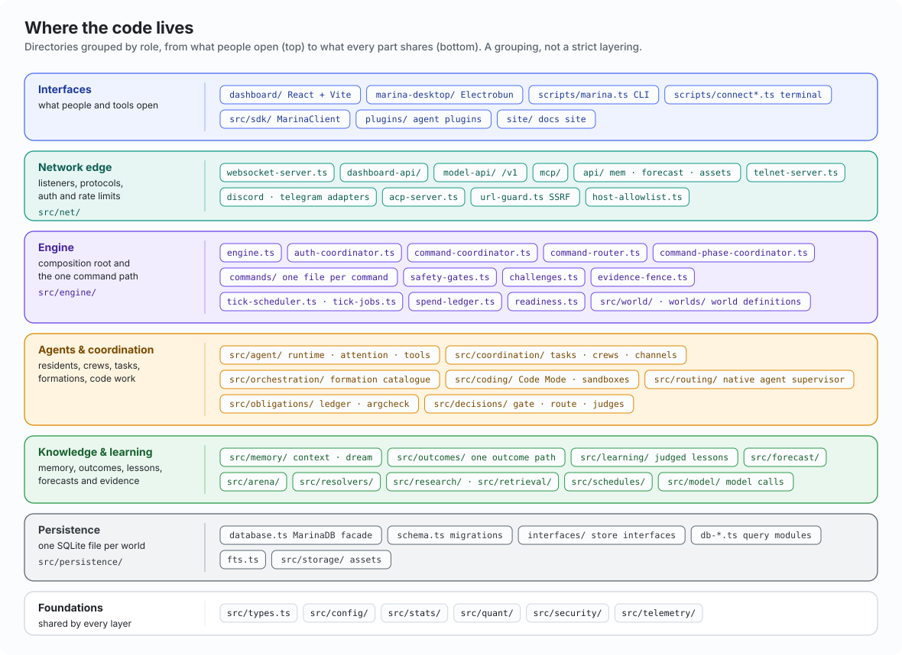

# Marina Architecture in Diagrams

**When to read this:** you are new to Marina, or reviewing it, and want to see the system before reading about it. Eight diagrams go from the whole system down to one command, one agent, memory, trust, the model gateway and learning. Each diagram has a short guide to reading it and links to the page with the details. Read them in order the first time: each one zooms into a part of the one before.

| # | Diagram | Shows |
|---|---|---|
| 1 | [Marina at a glance](#1-marina-at-a-glance) | Who connects, the one server process, the outside services |
| 2 | [Where the code lives](#2-where-the-code-lives) | The repository's directories grouped by role |
| 3 | [The life of a command](#3-the-life-of-a-command) | The one path every action takes, including held commands |
| 4 | [How a resident agent thinks](#4-how-a-resident-agent-thinks) | The continuous agent loop and where it meets the world |
| 5 | [Memory](#5-memory-one-history-one-retrieval-surface) | Write paths, the canonical record history, retrieval, usefulness, dreams |
| 6 | [Trust](#6-trust-standing-is-earned-gates-are-proven) | Standing from verified work, safety gates proven by people's approvals |
| 7 | [The model gateway](#7-the-model-gateway-v1) | The `/v1` endpoint every model call goes through |
| 8 | [How Marina learns](#8-how-marina-learns) | Outcomes into judged lessons; defaults changed only by earned promotion |

**Colour key** (the same in every diagram, in light and dark themes):

| Colour | Meaning |
|---|---|
| Blue | people and their clients |
| Teal | the network edge: listeners, protocols, the model gateway |
| Violet | the engine and its command path |
| Amber | agents, and what reaches them |
| Green | memory, outcomes and learning |
| Rose | trust and safety: gates, challenges, verification |
| Slate | storage |
| Grey | programs and services outside Marina |

Solid boxes are parts of Marina; dashed outlines group the things that connect to it. Arrows point the way data or control moves, and a label on an arrow says what moves.

---

## 1. Marina at a glance

Marina is **one Bun process and one SQLite file per world**. Three kinds of participant reach it:

- **People** use the web dashboard or desktop app, the `marina` terminal, Discord, Telegram or telnet.
- **Programs** call the OpenAI-, Anthropic- and Ollama-compatible model API, the SDK (`MarinaClient`), or federate as another Marina.
- **Agents** are Marina's own residents, Claude Code and Codex over MCP, native agents (Claude, Codex, pi) run as supervised residents through the native agent supervisor, and editors over the Agent Client Protocol.

Whatever the door, an action becomes a **world command** and takes the single path inside the engine: admission, authority, then a handler. Handlers call the subsystems — agents, memory, Code Mode, orchestration, decisions, outcomes, forecasting and the model gateway — and every change lands in the world database.

The point to take away: Marina's own residents are **clients**. An agent spawned in-process still logs in over the same WebSocket protocol as a person and is held by the same gates. There is no back door for agents.

Details: [worlds.md](worlds.md) · [security.md](security.md) · [persistence.md](persistence.md) · [Connecting](../guides/connecting.md)

## 2. Where the code lives

The repository grouped by what each directory is for, from the surfaces people open at the top to the code everything shares at the bottom. It is a map, not a layering rule: modules do import across bands (persistence uses engine types, memory uses persistence), so read it as "where do I look", not "what may import what".

Three conventions make the map navigable:

- **One file per command** in `src/engine/commands/`, registered in `src/engine/command-registry.ts`. A command's `CommandDef` (category, help, structured usage) generates help, the MCP tools and the dashboard forms, so a new command needs no separate schema.
- **One store per domain** in `src/persistence/`: `MarinaDB` is a thin facade over `db-*.ts` query modules, each behind an explicit interface in `interfaces/`.
- **Large surfaces are split by concern** under a directory with an entry file that re-exports a stable surface: `src/net/model-api/`, `src/net/dashboard-api/`, `src/agent/tools/`, `src/engine/commands/code/`.

Details: [`CLAUDE.md` → Key Files](../../CLAUDE.md#key-files) · [Contributor workflows](../guides/contributor-workflows.md)

## 3. The life of a command

Every action — a person typing, an agent's tool call, an MCP request, a schedule firing — takes this path. Follow the numbers:

1. **Ingress.** Every listener hands the text to `engine.dispatchCommand()`.
2. **Admission.** `CommandCoordinator` checks capacity, then queues the command on the entity's own FIFO. One entity's commands run strictly in order; different entities interleave fairly.
3. **Resolve.** An active modal may rewrite the input, a family form (`memory recall …`) forwards to its member, then a room's own command wins over a builtin of the same name, and macros come last (room, own, system).
4. **As-of fence.** When the execution carries an evidence cutoff, only the commands the fence policy lists run — those that bound themselves to the cutoff, and those that read nothing dated; anything else is refused, failing closed.
5. **Authority.** A rank floor, or the command's safety gate (the gate alone decides). A command that does not pass is **held**: a challenge token goes to the requester's owner and operators and the command returns at once. Nothing — no tool call, command or tick — waits for a person. When a person approves, the held input re-runs in the requester's own slot with a single-use pass.
6. **Handler.** Runs with a `CommandContext` inside the 150 ms command-phase budget. A refusal goes through `refuseCommand`, so usage records a failure and an agent's tool call rejects instead of reading an error as success.
7. **Write.** Through the `MarinaDB` facade into SQLite; operations that touch several rows commit in one transaction.
8. **Event.** One `EngineEvent` per mutation, emitted at the write site, feeds dashboard stores, the feed timeline, traces and listeners such as standing.

Separately, the handler's reply, room broadcasts and tells reach people and agents as **perceptions**; for an agent, attention (diagram 4) decides which of them wake it.

Details: [civic-substrate.md](civic-substrate.md) (gates, challenges, the as-of fence) · [persistence.md](persistence.md) (the command phase, durable keys) · [Commands](../guides/commands.md)

## 4. How a resident agent thinks

A resident is a participant, not an assistant: it runs continuously and acts on its own goals. Each cycle:

1. **Perceive.** World events arrive over the agent's WebSocket connection.
2. **Attend.** `assessPerception` — a pure function — decides keep or drop, priority, whether a reply is owed, and whether to wake the agent now or at its next cycle.
3. **Compose.** A byte-stable system prompt (so the provider's prompt cache keeps hitting) plus a continuation prompt of budgeted sections: world events, messages awaiting a reply, focus, and recalled memory and skills from the unified context.
4. **Think.** One model turn through pi-agent-core, either with the provider's own key or through Marina's `/v1` with a tier alias such as `marina/cheap`.
5. **Act.** Each tool call passes a policy check, the optional decision gate and the argument check, then becomes an ordinary world command. The server applies the same rank, gates and challenges as for a person.
6. **Record.** Every completed message is journaled before the loop advances. Over the conversation cap the history is archived first, then compacted; a failed archive keeps the full history.

Around the loop: every turn either acts or rests deliberately (`memory set rest <why>`); an idle turn writes one reflection and a goal update, never curation; an hourly dream pass proposes and checks consolidation of the agent's own notes, applying it only when `MARINA_DREAMING=on` (diagram 5); and every turn, step or time budget ends in an answer, labelled as forced when it was.

Details: [agent-cognition.md](agent-cognition.md) · [Agent development](../guides/agent-development.md) · [Agent prompt architecture](../guides/agent-prompt-architecture.md)

## 5. Memory: one history, one retrieval surface

![Memory architecture: six write paths land in one canonical versioned record history with numeric handles in the same transaction, an FTS5 index and access scopes. One retrieval surface serves five fixed-order tiers within a byte budget. Each serve is logged; mechanical raters build a per-item posterior that, when ranking is on, re-ranks shared retrieval by at most 0.1. An hourly dream pass proposes typed consolidation ops, checks them, applies them in a transaction and rolls back in observe mode.](../assets/architecture-memory.svg)

- **Writes.** Memory commands, MCP memory tools, the REST APIs, the agent's journal, judged lessons and text extracted from media all land in **one canonical record history**. A correction is a new version; `resolve` closes the losing record but keeps it readable. The numeric `note #N` handles that older integrations use are written in the same SQLite transaction, never as a second store.
- **Reads.** `buildUnifiedContext` is the only retrieval surface. It returns five tiers in a fixed order — `[skills]`, `[trusted]`, `[evidence]`, `[proposal]`, `[unverified]` — within one byte budget, so the agent prompt, `recall`, `GET /mem/context`, MCP context and passthru injection all see the same thing for the same query. Under an as-of fence it serves only what was known at the cutoff. Retrieval is lexical (FTS5) by default; embeddings stay off until evidence earns them.
- **Usefulness.** Every serve is logged as exposure. Mechanical raters (a citation, the outcome of the work, an explicit vote, a serve that went unused, a near-repeat) build a posterior per item. With usefulness ranking on (it observes by default), that posterior moves **shared** retrieval by at most ±0.1; nothing ever weights an agent's own notes by its own ratings.
- **Dreams.** An hourly pass picks writers with enough new material and a quiet half-hour, gathers their notes, makes one cheap model call that proposes typed operations (merge, supersede, link, decay), checks each one mechanically, and applies the set inside a transaction with probes re-run on that view. In the default `observe` mode the transaction is always rolled back. In `on`, merges, links and decays stay; a supersede becomes a proposal the owner adopts. Every applied dream can be rolled back.

Details: [memory.md](memory.md) · [Memory](../guides/memory.md) · [Memory workflows](../guides/memory-workflows.md)

## 6. Trust: standing is earned, gates are proven

Two separate questions, two mechanisms:

- **Standing — what have you contributed?** Only work that **another account** verified earns it: an approved task, a Code Mode attempt whose checks passed, a resolved forecast, a replicated experiment. Self-verification is refused, and an agent inside the same lineage counts only when its verdict is grounded (checks passed). Standing decays with a 60-day half-life and never goes negative. Ranks 0–4 are a descriptive lookup on it (5, 15, 40, 100); above rank 4, standing never promotes anyone.
- **Safety gates — may you do this?** There are 15 safety gates. An earnable gate has a low standing floor and becomes solo after a few held runs that a person approved once from outside the requester's lineage. The six operator-grant gates (`key.manage`, `admin.destructive`, `shell.exec`, `code.exec.unrestricted`, `world.code`, `trading.live`) have no floor and no demonstrations.

**People approve; agents never do.** A held command never blocks: the agent's turn goes on and the action runs when someone approves. Two environment-only switches set the posture: `MARINA_PROFILE` (`local`, `shared`, `public`) and `MARINA_AUTONOMY` (`guarded`, `earned`, `open`, `sovereign` — the one all-gates-off switch). Some things are never off in any profile: the exec-decision audit, the cognitive ledger, memory receipts and the trusted/unverified labels.

Details: [civic-substrate.md](civic-substrate.md) · [Civic substrate guide](../guides/civic-substrate.md) · [chronicle.md](chronicle.md)

## 7. The model gateway: `/v1`

`/v1` speaks the OpenAI, Anthropic and Ollama wire formats, so an existing app can point at Marina unchanged. Marina's own agents call it too when they run on a `marina/*` model; an agent with its own provider key calls the provider directly. Either way, every model dollar is recorded once in the same spend ledger.

- **Edge.** Host allowlist, bearer authentication, a per-client rate limit, and the world's daily spend cap (`429 spend_cap_reached`).
- **Two modes.** In *passthru* the request is proxied to a real model, with tier aliases (`marina/cheap`, `marina/strong`) resolved per request. In *agents* mode, the model `marina` is answered by residents in the world. Marina's own agents always take passthru.
- **Instrument stack.** An identified caller (a bound key, an authorized name mapping, or any caller under the local profile) gets four instruments by default: judged lessons, an obligations ledger, an argument check on write calls, and learning signals. The caller's own memory (`context`) follows its own opt-in rules, and answer verification and the ensemble are opt-in. Anonymous callers get none by default, so their requests pass through byte-identical. A header (`x-marina-stack`) or a model prefix chooses explicitly.
- **Upstream.** A key past its usage limit is avoided until its reset; meanwhile the **same** model is served via OpenRouter and labelled as such — never a different model.
- **Records.** Spend is recorded once, where the dollar leaves Marina; each request emits lifecycle trace events and returns its id in `x-request-id`.

Details: [passthru.md](passthru.md) · [traces.md](traces.md) · [Model API](../guides/model-api.md)

## 8. How Marina learns

**Every outcome teaches.** A task verdict, a Code Mode check or a resolved forecast becomes **one append-only outcomes row** — numbers and labels, never the question's text. A recurring pattern in an agent's own work (tool errors, gate holds, bounced submissions) skips the row and goes straight to the same judged lesson learner. Each outcomes row is delivered durably to its consumers:

- `lessons`: a judge turns the outcome into one general rule, or nothing; a candidate with no rule is never stored, and only trusted lessons are served. Benchmark runs teach through their own learner, which rejects anything that would leak an item's content.
- `usefulness`: rates the memory that was served during the work.
- `history` (forecasts only): records the formation and score, the evidence for routing the next similar question.

Deliveries wait rather than drop when over budget or when no model is available. Lessons come back to the next attempt through the agent's `[Lessons]` prompt line, `recall`, forecasting, and the `/v1` lessons instrument.

**Defaults change only by earned promotion.** A model, formation or setting replaces a default only when ledger evidence shows a held-out win: the paired interval above zero and the gain past a margin that grows with the number of configurations tried. It is filed under the `role.edit` gate and never by the author of the winning run; a promotion from live evidence (`role-model:<role>`) and adopting an imported seed also need a person. Every surface reads a default through one traced resolver (`resolveDefault`): environment, then the local slot, the family slot, an imported seed, and finally the built-in.

Details: [memory.md → Outcome lessons](memory.md#outcome-lessons-srclearning) · [benchmarks.md](benchmarks.md) · [forecasting.md](forecasting.md) · [orchestration.md](orchestration.md)

---

## About these diagrams

Each diagram is a standalone SVG in [`docs/assets/`](../assets/) (`architecture-*.svg`) with its own light and dark palette, a `<title>`, and a `<desc>` that states the diagram's claim for screen readers. They are hand-drawn from the code, not generated from it. When a mechanism shown here changes, update its SVG text in the same change as the code and the deep-dive page.
